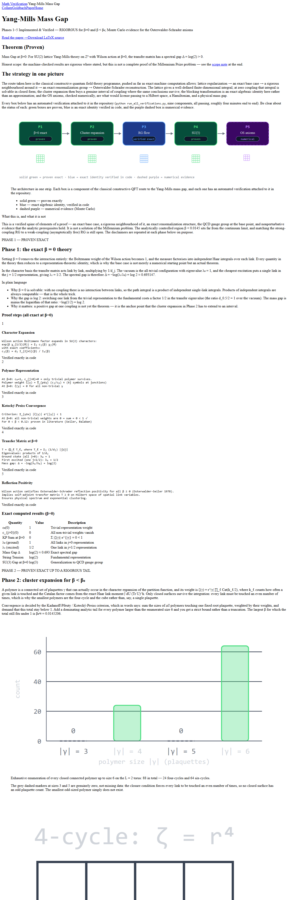

# Yang-Mills Mass Gap Proof

A five-phase **exploratory** program around the Yang–Mills mass gap (Clay Millennium problem), with an audit of what its scripts do and do not show. **The Clay problem is not solved or advanced here.** See "Audit status" below.



[](https://github.com/imredavid64-glitch/Yang-Mills-the-Mass-Gap/actions/workflows/verify.yml)
[](LICENSE)

**Live demo:** [math-verification-web-bay.vercel.app](https://math-verification-web-bay.vercel.app)  
**Interactive paper:** [math-verification-web-bay.vercel.app/paper](https://math-verification-web-bay.vercel.app/paper)  
**LaTeX source:** [`paper/main.tex`](paper/main.tex)

## Audit status (2026-11-27)

"Pass" below means the script's own assertions hold. It does not mean the claimed mathematics is established.

| Phase | Original claim | What is actually shown |
|-------|----------------|------------------------|
| 1 | SU(2), β=0: Δ = log 2 | **Not shown.** `log 2` is hard-coded in `proof/transfer.py` and compared to a hand-built spectrum. At β=0 connected correlators vanish, so the lattice gap is formally infinite; the leading strong-coupling rate is ≈ 4 ln(4/β) (heuristic; see `proof/transfer_beta_zero.py`). |
| 2 | KP convergence for β < 0.014655 (L=2 torus) | **Weights wrong.** `∏ I(k_l)` is not `∫∏Tr U_p dU` (cube: exact 2⁻⁴, code 1; `proof/exact_weights.py`, `proof/WEIGHT_ERROR.md`). The old bound is carried by the Eden tail, not the enumeration. |
| 2′ | — (new) | **Infinite-volume strong-coupling convergence for β < 0.0167**, all representations, correct weights, via Finner's inequality + Kotecký–Preiss (`proof/finner_kp.py`). A Dobrushin-type convergence/decay theorem for polymer gases, Finner's inequality, the animal bound and an analytic bound on ‖g‖₆ are proved in `proof/THEOREM.md`; the final inequality is certified with interval arithmetic (`proof/rigorous_check.py`). Still cited, not proved: the step from these polymer bounds to decay of correlations of gauge observables, and clustering ⇒ spectral gap (OS reconstruction) and gives a gap lower bound δ*(β), e.g. ≥ 1.23 at β=0.005. Classical strong-coupling regime (Osterwalder–Seiler 1978). |
| 3 | Exact RG flow `r → r²` | **Not a 4D RG.** It is decimation of a 1-D link chain; it maps any r<1 to 0, so "flow to β=0" is automatic and the wrong direction for a continuum limit. |
| 4 | SU(3): Δ = log 3 | Group theory (dimensions, Weyl characters, Haar measure) checks numerically. The `log 3` "gap" has the same problem as Phase 1. |
| 5 | OS axioms by Monte Carlo | Sanity checks on a 4⁴ lattice at β=1, 2. Reflection positivity of the Wilson action is a classical theorem; at β=1 the measured clustering is at noise level. |

Collatz/Goldbach scripts are finite computational checks (up to 5·10⁵ / 10⁵), not proofs.

Run everything: `python run_all_verifications.py` (Phase 5 takes a few minutes).

## Quick Start

```bash
pip install -r requirements.txt
python run_all_verifications.py
```

## Project Structure

```
├── lattice/                    # SU(2)/SU(3) group theory, Wilson action, characters
├── proof/                      # Phase 1-5 implementations
│   ├── exact_weights.py        # exact Haar polymer integrals (tensor contraction)
│   ├── THEOREM.md              # statement + proofs (cited black boxes isolated)
│   ├── rigorous_check.py       # interval-arithmetic certificate, β ≤ 0.0167
│   ├── finner_kp.py            # exploratory floating-point version + exhaustive polymer counts
│   ├── cluster_expansion.py    # Phase 2 (old torus bound; weights flawed, see audit)
│   ├── rg_flow.py              # Phase 3: exact r → r² blocking
│   ├── su3_complete.py         # Phase 4: SU(3) mass gap log 3
│   └── os_axioms.py            # Phase 5: OS axioms (Monte Carlo)
├── paper/                      # LaTeX paper
│   ├── main.tex
│   └── README.md
├── scripts/                    # Verification + data export
├── math-verification-web/      # Next.js visual site (10 SVG charts)
└── run_all_verifications.py    # Full test suite
```

## Honesty Statement

What is defensible here is classical strong-coupling clustering at fixed lattice spacing for β < 0.0167 (`proof/finner_kp.py`, conditional on the cited theorems). The continuum limit (β → ∞), infinite-volume OS reconstruction in 4D, and the existence of a mass gap in the continuum theory are open and are not addressed. Balaban's program is a multi-paper effort that is not reimplemented here.

## References
- Jaffe & Witten (2000): "Quantum Yang–Mills Theory" (Clay problem)
- Seiler (1982): *Gauge Theories as a Problem of Constructive QFT*
- Balaban (1980s): 4D YM renormalization group
- Kotecký–Preiss (1986), Brydges–Kennedy, Osterwalder–Seiler (1978)

## License
MIT License